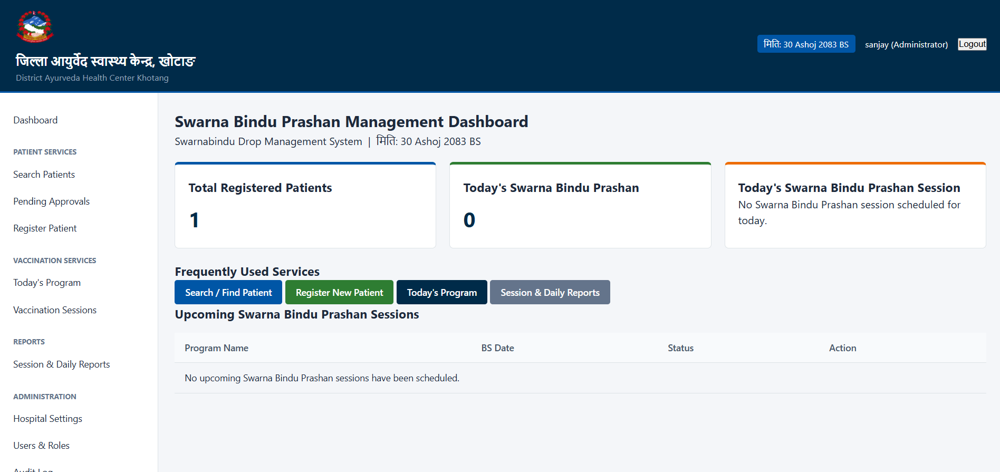

# Swarnabindu Care

A patient and vaccination management system built for a government health facility in Nepal.



**[Try Swarnabindu Care](https://ahckhotang.ggsrclub.com/)**

## Quick Start

Open the [live application](https://ahckhotang.ggsrclub.com/) to access the deployed system.

## Features

- **Patient records:** Register and manage patient information in one place.
- **Vaccination tracking:** Maintain vaccination records and histories.
- **Immunization sessions:** Manage vaccination schedules, including changes to session dates.
- **Family-linked records:** Associate multiple children with shared family contact information.
- **Nepali date support:** Work with Bikram Sambat dates alongside the needs of local healthcare services.
- **Staff access and reporting:** Support different staff roles and generate reports for hospital records.

## Run Locally

### Requirements

- Python 3.11
- PostgreSQL
- Git

### Setup

Clone the repository and enter the project directory:

```bash
git clone https://github.com/dashing-dev/swarnabindu_care.git
cd swarnabindu_care
```

Create and activate a virtual environment.

**Windows (PowerShell):**

```powershell
py -3.11 -m venv .venv
.venv\Scripts\Activate.ps1
```

**Linux or macOS:**

```bash
python3.11 -m venv .venv
source .venv/bin/activate
```

Install the dependencies:

```bash
python -m pip install -r requirements.txt
```

### Database Configuration

Create a PostgreSQL database and configure the application's database credentials using the configuration expected by the project. Set the required environment variables or settings before continuing.

Apply migrations and create an administrator account:

```bash
python manage.py migrate
python manage.py createsuperuser
```

Collect static files and start the development server:

```bash
python manage.py collectstatic
python manage.py runserver
```

Open `http://127.0.0.1:8000/` in your browser.

## How It Works

Swarnabindu Care is built with Django and PostgreSQL. Django handles the application's server-side logic and data management, while PostgreSQL stores patient and vaccination records.

The system is designed around the requirements of a local government health facility, with support for Bikram Sambat dates, family-linked patient records, configurable vaccination sessions, and role-based staff access.

**Test Credentials**
ID : ```guest```

Password : ```/@Guest123/```
